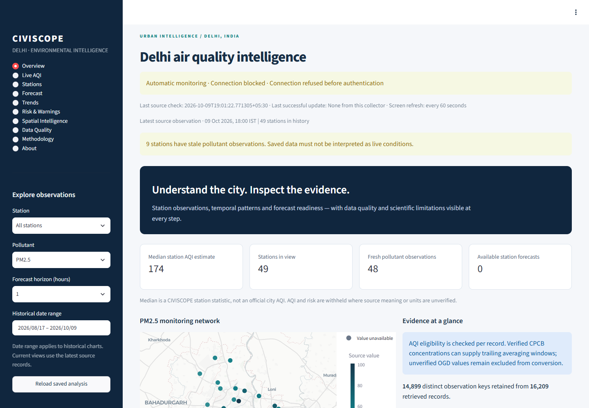

# CIVISCOPE

**Delhi air-quality analytics with transparent data quality**

A ten-page Streamlit dashboard by Mayank Raj, built with Python, pandas, NumPy and Plotly. Explore station observations, pollutant trends, maps, calculated AQI estimates, and the evidence behind each result.

[Portfolio](https://mayank-raj-the-series.adoredteal16.chatgpt.site) · [Methodology](docs/methodology.md) · [Architecture](docs/architecture.md) · [Recorded validation](docs/final_report.md)



## Project at a glance

| What | Recorded evidence |
| :--- | :--- |
| Interface | Ten dashboard pages, station/date/pollutant filters, charts and CSV export |
| October 9, 2026 data run | 14,899 distinct observations across 49 station names |
| AQI | 47 eligible station estimates at validation time; calculated by CIVISCOPE |
| Quality controls | Provenance, source units, missing values, validation gates and output checksums |
| Forecasting | Predictions withheld when independently available history is insufficient |

These counts describe a recorded snapshot, rather than a continuously available live feed. Estimates are not official published AQI. Use the saved data to reproduce the dashboard; source connectivity and adequate future histories remain external requirements.

Delhi air-quality intelligence, station analytics and responsible experimental forecasting.

CIVISCOPE turns preserved government-source snapshots into auditable station observations, temporal analysis, quality reports, eligible AQI calculations and evidence-bearing warnings. This publication contains the application, tests and preserved historical observation snapshots. Private PC documents, credentials, runtime state and generated outputs are excluded. Historical government observations are supplied in `historical-snapshots.zip`; the preparation command restores them without overwriting different existing snapshots.

## Current readiness

The ten-page dashboard now includes official CPCB concentration tables retrieved October 9, 2026, with completed measurements through 18:00 IST and 47 eligible station AQI estimates at validation time. These are CIVISCOPE calculations, not official published AQI. The OGD API still refuses connections; the CPCB snapshot was retrieved through the visible portal after a user-completed CAPTCHA and does not refresh automatically. Forecasts remain withheld because independently available history is insufficient. The older August archive retains unknown units and is shown separately from verified concentrations. No model skill is claimed merely because software tests pass.

## Start on Windows

Use Python 3.11 and run these commands from the project root:

```powershell
python -m venv .venv
.\.venv\Scripts\python.exe -m pip install -r requirements.txt
.\.venv\Scripts\python.exe scripts/prepare_data.py
.\.venv\Scripts\python.exe -m src.pipeline.run_pipeline
.\.venv\Scripts\python.exe -m streamlit run src/dashboard/app.py
```

The existing `.venv` may be reused. Open the local URL printed by Streamlit. No API key is required to analyze the saved archive.

For a single official-source refresh, copy `.env.example` to `.env` only if `.env` does not already exist, configure `OGD_API_KEY`, then run:

```powershell
.\.venv\Scripts\python.exe -m src.pipeline.run_pipeline --collect
```

Collection failure retains the last successful analytical run. Requests have bounded retries, timeouts and pagination checks; errors do not print credential-bearing request URLs. Live API availability is an external dependency.

A collector checks the official API every 15 minutes and publishes complete validated updates when collection succeeds:

```powershell
.\.venv\Scripts\python.exe -m src.run_collection
```

Stop a foreground collector with Ctrl+C. Only one collector can run at a time. `--interval 900` controls the check interval and `--once` runs one cycle. The dashboard refreshes every 60 seconds and displays collector connection status, last check and last successful update. Collection remains separate from widget interactions. A blocked source does not count as a successful update. The collector runs only when launched; this repository does not install a background service.

## Features

- Immutable raw snapshots with source and retrieval provenance.
- Separate source observation and collection timestamps, displayed in IST.
- Canonical pollutant labels for PM2.5, PM10, NO2, SO2, O3, NH3, CO and Pb.
- Identity, numeric, coordinate, range, duplicate, conflicting-record and freshness checks.
- Shared AQI interpolation and diagnostics, with explicit source-unit and averaging eligibility.
- Independent station/pollutant forecasts for 1, 3, 6, 12 and 24 hourly-clock horizons when history supports them.
- Chronological model selection and later evaluation with a horizon embargo.
- Station-specific trends, disclosed analytical risk components, stale-data warnings and potential anomalies.
- Versioned outputs, input/output checksums, strict JSON and atomic promotion of complete runs.
- Overview, Live AQI, Stations, Forecast, Trends, Risk & Warnings, Spatial Intelligence, Data Quality, Methodology and About pages.
- Station, pollutant, date and horizon filters; selected-observation CSV export; interactive maps and Plotly charts.

## Data and scientific interpretation

Primary source: [OGD real-time AQI catalog](https://www.data.gov.in/catalog/real-time-air-quality-index). Resource identifier: `3b01bcb8-0b14-4abf-b6f2-c1bfd384ba69`.

Additional current source: [official CPCB advance-search tables](https://airquality.cpcb.gov.in/ccr/#/caaqm-dashboard-all/advance-search). The historical snapshots included here retain the imported observations and source metadata; raw portal captures remain in the original local archive. The new `src/import_cpcb.py` validates table headers, units, counts and completed intervals before creating historical snapshots. See `docs/data_sources.md` and `docs/live_setup.md` for provenance and refresh limitations.

CPCB methodology defines pollutant-specific concentration units and averaging periods. CIVISCOPE does not infer these fields from a pollutant label or convert CO using an assumed scale. Source values with unverified meaning remain visible in their source-reported scale, but cannot be fed automatically into concentration-to-AQI conversion.

Eligible station estimates need aligned, fresh observations of at least three pollutants including PM2.5 or PM10. City summaries are labelled station statistics. They are not official published Delhi AQI. Open-ended severe concentration ranges receive a category diagnostic without an invented numeric extrapolation.

Risk uses the existing AQI tier formula and observed station trend adjustments. It is a CIVISCOPE analytical score. Missing or stale AQI produces unavailable risk. Missing warnings do not establish safe conditions. No medical advice or causal pollution-source attribution is generated.

## Forecasting

Naive, three-value rolling mean and a recent linear trend are compared independently for each station/pollutant/horizon. Missing hours are never filled. Training includes only source measurements retrieved by the forecast origin. At least 24 contiguous training hours and 12 origins in each model-selection/evaluation segment are required. A recent 30-day window bounds computation.

MAE, RMSE and nonzero-target MAPE are scoped to the selected station, pollutant and horizon. Confidence labels follow a documented project rule; they are not probabilities. Source-value forecasts are not concentration or AQI forecasts without corresponding provenance.

## Testing

Check the current live prerequisites explicitly:

```powershell
.\.venv\Scripts\python.exe -m src.readiness
```

The command makes one bounded official API sample request and checks saved output integrity, freshness, station AQI availability and forecast expiry. It writes `data/diagnostics/live_readiness.json`, displayed on Data Quality. Exit code 1 means a prerequisite failed; `--offline` skips the request and cannot establish live connectivity. See [live setup](docs/live_setup.md) for the current blockers and recovery sequence.

```powershell
.\.venv\Scripts\python.exe -m unittest discover -s tests -v
```

Offline tests cover AQI boundaries, invalid and conflicting data, repeated retrievals, station isolation, publication-time exclusion, chronological evaluation, ingestion errors, output integrity, atomic failure recovery and dashboard behavior. Generated fixtures are confined to tests and temporary directories.

The live API test is opt-in and requires `CIVISCOPE_LIVE_API_TEST=1` plus a configured key. The normal suite does not send network requests.

See `docs/final_report.md` for actual check results and remaining limitations; do not interpret the feature list as proof of validated forecast skill.

## Project structure

```text
src/core/                         source identity and observation validation
src/collect_historical.py         bounded official-source collector
src/readiness.py                  explicit live prerequisites and safe diagnostics
src/trend_analysis.py             independent station trends
src/production/aqi_analysis.py    canonical AQI calculation and eligibility
src/production/_forecast.py       forecasting and chronological evaluation
src/production/risk/              analytical risk
src/production/warning/           evidence-bearing warnings
src/production/intelligence/      station summaries and report generation
src/pipeline/run_pipeline.py      complete run construction and promotion
src/dashboard/                   presentation, maps, charts and verified loading
tests/                           offline regression and UI tests
data/historical/                 preserved official-source snapshots
data/processed/runs/             versioned analytical outputs
data/processed/latest_run.json   complete-run manifest consumed by the dashboard
data/logs/                       structured pipeline events
docs/                            audit, architecture, methodology and validation
```

Legacy analytical scripts delegate to the consolidated pipeline. Original implementations are retained in the source archive. Older flat CSV products are preserved as historical artifacts and are not consumed by the upgraded dashboard. Read-only exploratory tools remain available, but their legacy summaries do not certify scientific eligibility.

## Documentation

- [Audit findings](docs/audit_initial.md)
- [Architecture](docs/architecture.md)
- [Scientific methodology](docs/methodology.md)
- [Data sources and provenance](docs/data_sources.md)
- [Model validation](docs/model_validation.md)
- [Validation report](docs/final_report.md)
- [Live setup and recovery](docs/live_setup.md)

## Limitations and research directions

Operational readiness requires reliable collection, verified source-value semantics and enough independent station history. Seasonal analysis, calibrated prediction intervals, meteorology, satellite integration, causal attribution, policy simulation and drift monitoring require additional data and validation. They are future research directions, not implemented capabilities.