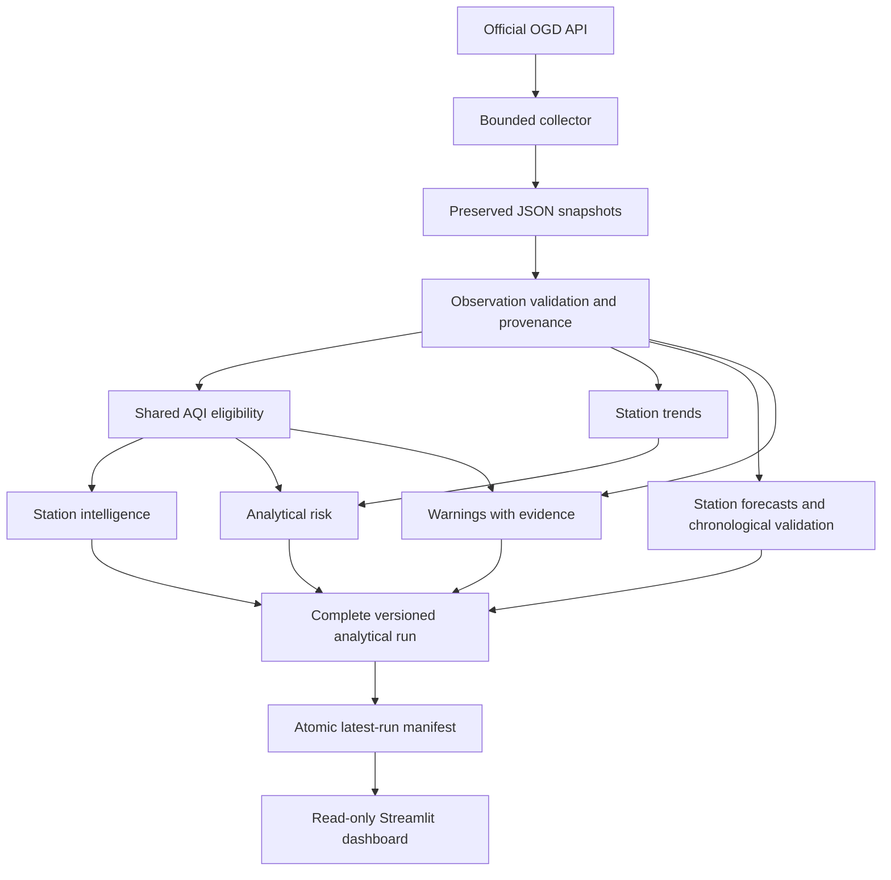

# CIVISCOPE architecture

The application preserves the existing Python/Streamlit project and consolidates production calculations in their original module locations. Business logic is independent of Streamlit.

## Contracts and boundaries

`src/core/data.py` validates raw records and returns one row per station/pollutant/observation timestamp plus a quality report. Retrieval time represents first known availability. Conflicting source values or metadata are quarantined. Missing coordinates are retained as unavailable so that unmappable stations remain represented.

`src/production/aqi_analysis.py` owns all finite concentration interpolation, categories and metadata eligibility. It returns numeric results only when input meaning and units permit them. Other modules reuse it.

`src/production/_forecast.py` owns station forecasting, baseline comparison and chronological evaluation. Each output identity is station/pollutant/horizon. A status row exists even when no forecast can be produced. City-level forecasts are not merged into station outputs.

`src/pipeline/run_pipeline.py` constructs all frames, checks duplicate identities and AQI consistency, round-trips CSV contracts, hashes inputs/outputs, writes strict JSON, and finally atomically replaces `latest_run.json`. An incomplete run directory is never promoted. Existing raw/history files and older successful runs remain intact.

`src/dashboard/data_access.py` verifies schema version, complete file checksums, safe relative paths and required columns. The dashboard caches loaded frames by manifest signature for up to 60 seconds. Freshness and forecast expiry are evaluated at display time.

## Files in a run

- `observations.csv`: validated historical observations, source file and retrieval provenance.
- `aqi.csv`: latest station/pollutant records with sub-index, status and reason.
- `trends.csv`: station-specific comparisons within an allowed interval.
- `forecasts.csv`: independent station/pollutant/horizon predictions or unavailable reasons.
- `validation.csv`: model-selection and held-out prediction records.
- `stations.csv`: station summaries, coordinates, coverage and eligibility.
- `risk.csv`: transparent analytical risk components.
- `warnings.csv`: identified conditions, severity, evidence and status.
- `coverage.csv`: observed/expected hourly-bin coverage.
- `quality.json`, `report.json`, `manifest.json`: quality, explicit summary schema and reproducibility checksums.

## Failure behavior

API failures abort collection without publishing partial snapshots. Malformed snapshots abort analysis and preserve the previous promoted run. Missing or unreadable analytical output produces a dashboard unavailable state. Scientific insufficiency is a supported status, rather than a pipeline exception or invented result.

Legacy analytical entry points delegate to the single pipeline. Read-only exploratory scripts and preserved flat CSVs are outside the new dashboard contract. Original implementations remain recoverable from the pre-upgrade archive.
